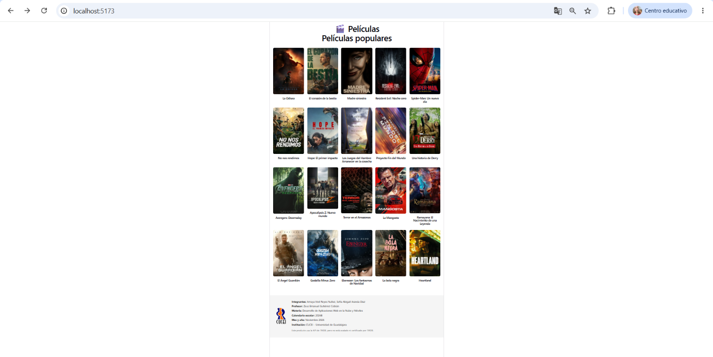
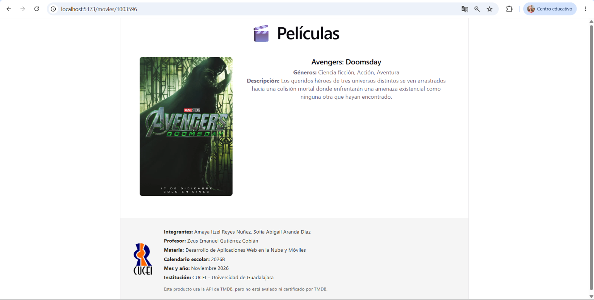
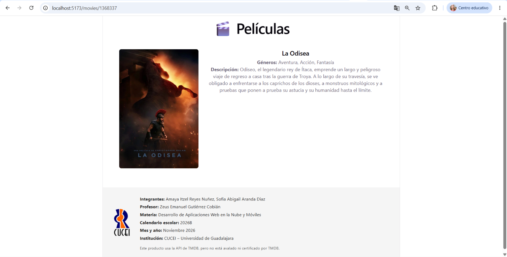
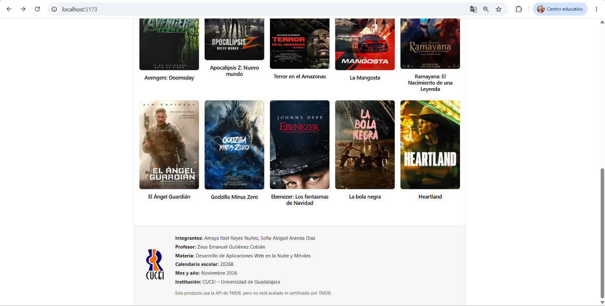

# Práctica 7 - App de Películas con React

## Integrantes

- Amaya Itzel Reyes Nuñez
- Sofia Abigail Aranda Diaz

**Materia:** Desarrollo de Aplicaciones Web en la Nube y Móviles

**Profesor:** Zeus Emanuel Gutiérrez Cobián

**Calendario escolar:** 2026B

## Objetivo

El objetivo de la práctica fue desarrollar una aplicación web usando Vite y React, que consumiera información de una API real de películas. La aplicación permite consultar un listado de películas y mostrar los detalles de cada una, incluyendo su póster, título, géneros y descripción.

Además, trabajamos de manera colaborativa en GitHub, realizando más de dos commits cada una y utilizando ramas para organizar nuestros cambios. Finalmente, conectamos el repositorio con Netlify para publicar la aplicación.

## Tecnologías utilizadas

- React
- Vite
- React Router DOM
- CSS
- API de TMDB
- Git y GitHub
- Netlify

## Estructura del proyecto

```text
practica7-react-peliculas/
├── public/
│   ├── favicon.svg
│   └── _redirects
├── src/
│   ├── components/
│   │   ├── Footer.jsx
│   │   ├── Footer.css
│   │   ├── MovieCard.jsx
│   │   ├── MovieCard.css
│   │   ├── MovieGrid.jsx
│   │   └── MovieGrid.css
│   ├── img/
│   │   ├── escudo-cucei.png
│   │   └── placeholder.png
│   ├── pages/
│   │   ├── LandingPage.jsx
│   │   ├── MovieDetails.jsx
│   │   └── MovieDetails.css
│   ├── routers/
│   │   └── AppRouter.jsx
│   ├── services/
│   │   └── httpClient.js
│   ├── utils/
│   │   └── getMovieImg.js
│   ├── App.jsx
│   ├── App.css
│   ├── index.css
│   └── main.jsx
├── .gitignore
├── index.html
├── package.json
└── vite.config.js
```

## Instalación y ejecución local

1. Clonar el repositorio.
2. Instalar las dependencias con `npm install`.
3. Crear un archivo `.env` en la raíz del proyecto y agregar la siguiente línea. Cada integrante debe utilizar su propia API key de TMDB:

   `VITE_TMDB_API_KEY=TU_API_KEY`

4. Ejecutar el proyecto con `npm run dev`.

## Rutas

- `/` : muestra el listado de películas.
- `/movies/:movieId` : muestra los detalles de una película seleccionada.

## API utilizada

Utilizamos la API de TMDB (The Movie Database) para obtener la información de las películas. En el proyecto realizamos dos peticiones principales:

- `/discover/movie`: obtiene el listado de películas que aparece en la página principal.
- `/movie/{id}`: obtiene los datos de la película seleccionada, como el póster, título, géneros y descripción.

Las peticiones se realizan desde `src/services/httpClient.js`. La API key se guarda en un archivo `.env` para evitar subirla directamente al repositorio de GitHub.

## Funcionamiento

La página principal muestra un listado de películas con su póster y título. Al seleccionar una tarjeta, se abre una página con los detalles de esa película, donde se pueden consultar su imagen, géneros y descripción. Al final de la aplicación también se encuentra un footer con los datos del equipo.









## Enlaces

- **Repositorio:** https://github.com/amayareyes/practica7-react-peliculas
- **Netlify:** https://practica7-react-peliculas-770z.netlify.app/

## Conclusiones

Con esta práctica logramos desarrollar una aplicación de películas con React y Vite que consume la API de TMDB. Aprendimos a mostrar un listado de películas y abrir sus detalles utilizando React Router. También trabajamos en equipo con GitHub y publicamos el proyecto en Netlify.

Una de las partes que más se nos complicó fue la organización con Git. Tuvimos que resolver conflictos al unir las ramas porque las dos habíamos creado archivos con el mismo nombre, como `App.jsx` y `MovieDetails.jsx`. Por eso, nos tocó revisar los cambios y decidir con qué versión continuar. También nos pasó que un commit que creíamos haber realizado no se había guardado, así que aprendimos a revisar los cambios con `git status` y `git log` antes de subirlos.

Otra cosa que aprendimos fue a manejar la API key mediante variables de entorno. La guardamos en un archivo `.env` que no se sube al repositorio y configuramos la clave por separado en Netlify. Durante la publicación también tuvimos que cambiar la visibilidad del proyecto para poder compartir el enlace.

En general, esta práctica nos ayudó a conocer mejor el uso de React, el consumo de una API externa y el trabajo colaborativo mediante GitHub.
